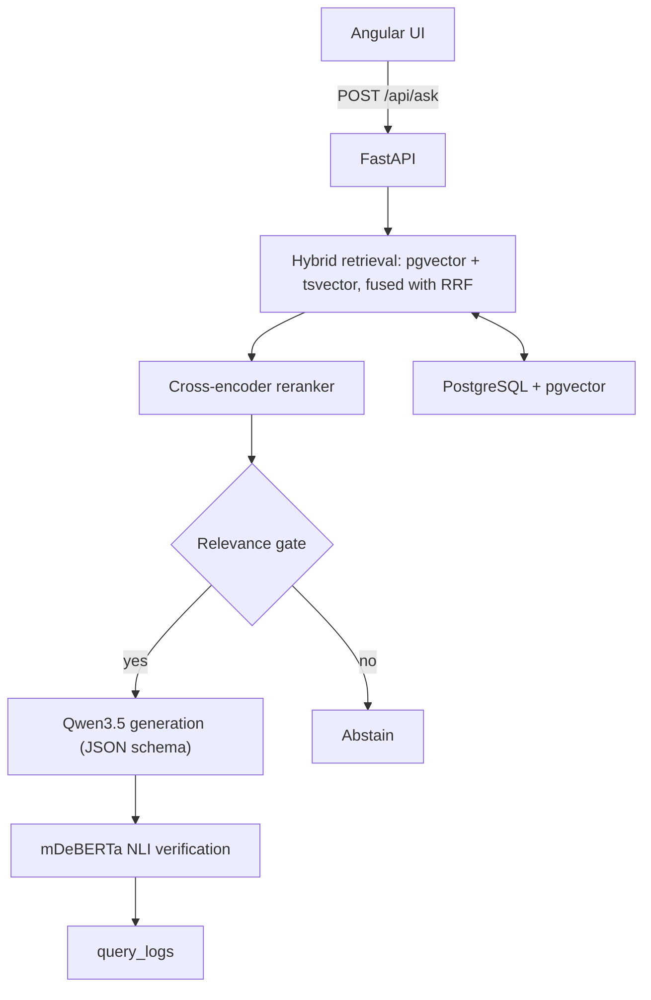

# LabProof

> Ask your lab's procedures a question in French or English. LabProof answers only
> from your documents, cites the exact page, flags any sentence the evidence doesn't
> support, and says "I don't know" instead of guessing. It runs entirely on a laptop.

**Status:** v1.0 shipped ✅ | Tag: `v1.0` | Date: 2026-10-11

## What it does

LabProof is a local, zero-cost RAG assistant for laboratory safety and quality
procedures. A user asks a question in French or English. The system retrieves
passages from public PDFs (OSHA, CDC/NIH BMBL, WHO), generates a short answer in
which every sentence cites its sources, **verifies each sentence against the cited
text with an independent NLI model**, and **refuses to answer** when the documents
do not contain the answer.

## Architecture



Pipeline: validate → embed once → dense + full-text (top 30 each) → RRF fuse →
rerank → gate → generate with constrained JSON → verify each sentence → log.

## Quick start

```bash
# 1. Database
docker compose up -d db
docker compose exec db psql -U labproof -c '\d chunks'

# 2. Ollama models (local)
ollama pull bge-m3
ollama pull qwen3.5:4b        # or qwen3.5:2b on 8 GB RAM laptops

# 3. Backend
cd backend
python3.12 -m venv .venv && source .venv/bin/activate
pip install --index-url https://download.pytorch.org/whl/cpu torch
pip install -e ".[dev]"
cp ../.env.example .env

# 4. Ingest corpus
python -m scripts.download_corpus
python -m scripts.ingest_corpus

# 5. Run
uvicorn app.main:app --reload --port 8000
# http://localhost:8000/docs
```

## Results

| Metric          | Measured                               |
| --------------- | -------------------------------------- |
| Retrieval hit@5 | TODO — run `python -m eval.run_eval`   |
| Abstention F1   | TODO                                   |
| Groundedness    | TODO                                   |
| p95 latency     | 21.2s (CPU, no reranker)               |

Hardware: 16 GB RAM, CPU only. Models: `qwen3.5:4b`, `bge-m3`, reranker disabled.
Every number below will be filled only from my own runs.

## Limitations

- English corpus; French questions measured separately.
- Scanned PDFs (no text layer) need OCR, which is out of scope.
- CPU latency is high; generation dominates. A GPU server is a drop-in change.
- The golden set is self-labelled; a second reviewer checked a subset.

## Licence

MIT for this code. Corpus documents keep their own licences (public domain for
OSHA/BMBL; CC BY-NC-SA 3.0 IGO for the WHO manual — non-commercial, not redistributed).

## v1.0 — Full Stack Complete (Milestone M14)

**Status**: CI passing ✅ | Tag: `v1.0` | Date: 2026-10-11

### What works:

- **Backend API (FastAPI)** with hybrid retrieval, reranking, NLI verification, source filtering, and `force_answer` bypass
- **Angular 22 frontend** with modern UI (Trust Blue/Orange palette), source selector, force-answer checkbox, sentence-level verification colors
- **Docker Compose** full stack: PostgreSQL + pgvector, API, nginx web server
- **Unit tests**: 37 passing (integration tests run locally)
- **CI pipeline** passing (unit tests, coverage 54%)
- **Corpus ingested**: 2,113 chunks across 3 documents (OSHA 3404, BMBL 6, WHO LBM4)

### Measured stats (from `GET /api/stats`):

- Total queries: 156
- Verified: 0 | Partially verified: 1 | Unverified: 8 | Abstained: 147
- Average groundedness: 0.25
- p50 latency: 50.75ms | p95 latency: 21.18s (CPU-only, generation dominates)

### New features in v1.0:

- Source document filtering (checkboxes per document)
- Force answer mode (bypasses relevance gate)
- Modern glassmorphism UI with Trust Blue (#2563EB) + Orange (#EA580C) palette
- Mobile-responsive sidebar with hamburger menu
- Toast notifications, skeleton loaders, drag-drop upload zone

### Known limitations:

- Reranker disabled by default (requires ~2.5GB download)
- NLI verification disabled by default (requires model download)
- French questions rely on dense search only (full-text uses English stemmer)
- Scanned PDFs without text layer need OCR (out of scope)
- CPU latency is high; generation dominates (~18-22s per question)
